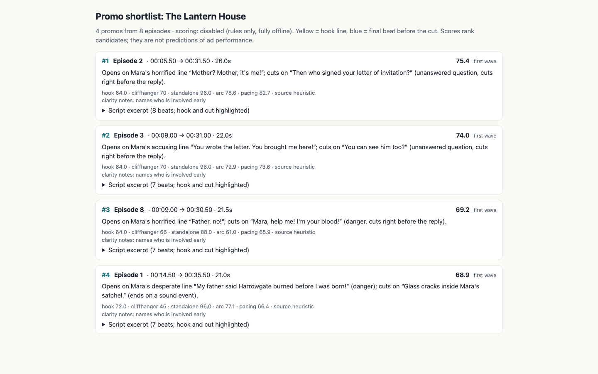
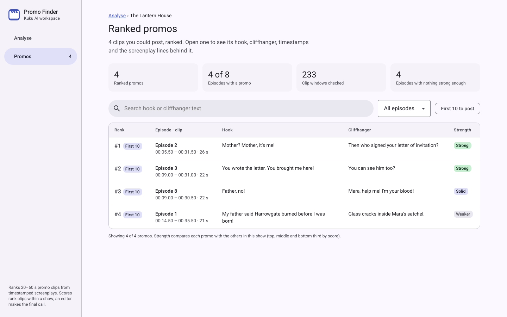
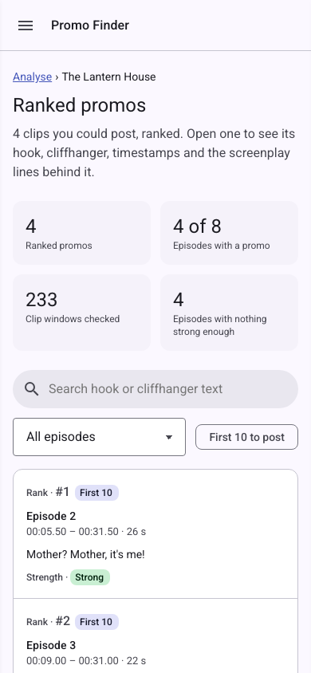
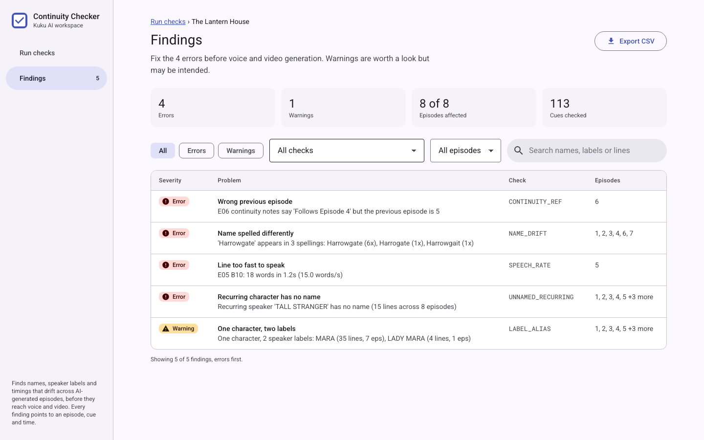
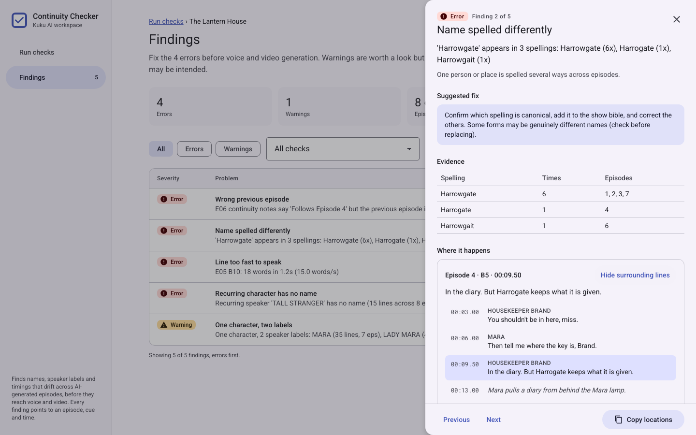
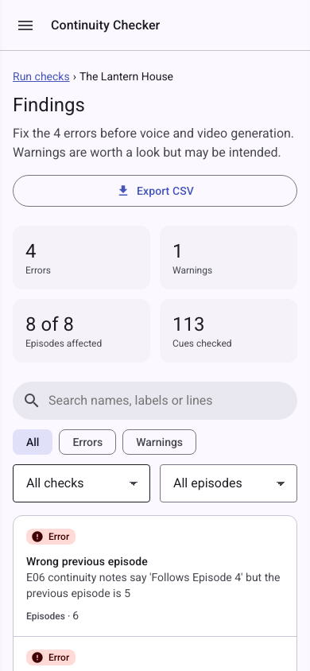

# A shared web interface for the three tools

After the main build I gave all three tools one consistent web interface, based on Google's Material Design 3 (details in [`DESIGN_SYSTEM.md`](DESIGN_SYSTEM.md)).
Before this, Promo Finder and the Continuity Checker only produced static report pages, so each now has a small web
app; Nyaya Sahayak's chat page was rebuilt. The engines, their outputs and every command-line tool are unchanged, and
all the tests still pass.

## Ground rules I kept to

The backend logic stays as it was. Promo Finder's pipeline gained one optional progress callback, used only to show
“episode 26 of 50”, and still produces the same 83 promos on the full pack. The Continuity Checker's web server calls
the same functions as its command line and gives the same 40 findings. Nyaya Sahayak's chat API is untouched.

Every button does something real, and every number on screen comes from the tool's own output. There are no new
dependencies: the servers use Python's standard library and the pages are plain HTML, CSS and JavaScript. Each project
still runs on its own.

The screenshots in the public repository use an invented eight-episode show, *The Lantern House*, so they contain no
Kuku material. Screenshots of the real show were taken too, but kept off the public repository.

## One design system

The three apps share one stylesheet and one small script. The colour scheme is built around a calm indigo, which reads
as serious without looking like an alarm, and gives a second, clearly different colour for marking cliffhangers next
to hooks. Text uses Roboto on a four-pixel spacing grid. All the main colour pairs meet the WCAG AA contrast standard:
body text is 16.3 to 1, secondary text 8.9 to 1, and white on the main buttons 6.5 to 1. Errors and warnings always
carry an icon and a word, never colour alone.

Each screen has one main action. Lists show only what is needed for a decision, and the detail opens in a side panel,
with the raw evidence (scores, screenplay lines, surrounding cues) folded away inside it.

## Promo Finder

Before, the only interface was a long static page of cards showing raw scores, with no search or filters. Now you
choose a show and click *Analyse screenplay*: the real pipeline runs with a progress bar, then a banner offers the
ranked list. The list has four summary numbers, a search box, an episode filter and a *First 10 to post* filter. Each
promo is labelled Strong, Solid or Weaker, meaning the top, middle or bottom third of scores within that show. Opening
a promo shows why it works, the hook and cliffhanger lines, the clip's details, the scores, and the screenplay excerpt
with both lines highlighted. You can step to the previous or next promo and copy the timestamps for the edit.

## Nyaya Sahayak

Before, it was a single page with a chat column, a dense facts box, plain-text citations and the notice as inline text.
Now it opens with three topic starters (refund, rent deposit and unpaid salary), which fill in a message with
[brackets] to complete, so nothing is sent before the user edits it. The message box grows as you type; Enter sends and
Shift+Enter starts a new line. Beside the chat, a case panel has four tabs: the facts it has understood, next steps,
sources, and the draft notice. Citations in a reply are buttons that open the matching source. The notice tab
highlights the blanks still to fill and can copy or download the notice.

## Continuity Checker

Before, it was a long static list headed by rule codes such as NAME_DRIFT, with no filtering. Now you click *Run
checks*, which takes about 0.2 seconds for 50 episodes, and get a summary of errors, warnings, episodes affected and
cues checked. Findings can be filtered by severity, type of check and episode, or searched, and each one leads with
plain language (“Name spelled differently”). The detail panel shows the suggested fix, the evidence (such as a table of
spellings with counts), and each location with a *Show surrounding lines* button. *Export CSV* downloads the same
triage spreadsheet as the command line.

## Before and after

All screenshots are in [`docs/screenshots/`](docs/screenshots/) (8 before, 34 after) and use the invented demo show.

| | Before | After |
|---|---|---|
| Promo Finder, list |  |  |
| Promo Finder, detail | (no detail view) |  |
| Promo Finder, phone |  |  |
| Nyaya Sahayak |  |  |
| Nyaya Sahayak, notice | (inline text) |  |
| Continuity Checker, list |  |  |
| Continuity Checker, detail | (no detail view) |  |
| Continuity Checker, phone |  |  |

## How I checked it

| Check | Result |
|---|---|
| Automated tests | Promo Finder 52 (including 4 new web tests), Nyaya Sahayak 18, Continuity Checker 19 (including 4 new web tests): all pass |
| Screenshot checks | 28 of 28 screenshots pass at 1440, 1280, 768 and 390 pixels wide: no sideways scrolling, no control smaller than 24 pixels, no console errors |
| Workflows by hand | Analyse, open a promo, step through, close with Escape (focus returns to the row); filters and search; the empty state; run checks, open a finding, show surrounding lines; CSV download; the phone navigation drawer |
| Real data | Both new apps run on the full 50-episode pack and match the command line: 83 promos and 40 findings |

Fixed along the way: a 3-pixel sideways scroll on phones, a misaligned message box, a button showing on desktop that
belongs only on phones, a breadcrumb link under 24 pixels, two competing main buttons, a stale “Not analysed yet” hint,
a grey shape on a disabled button, a squeezed filter on phones, redundant labels on phone cards, and English voice input
being entered twice.

## Limits

There is only a light theme so far. Roboto loads from Google Fonts, so offline the system font is used. The shared
style files are copied into each project to keep the projects independent, so a change has to be copied to all three.
The optional language-model features are still command-line only. Promo Finder keeps the status of a running analysis
in memory, so restarting the server mid-run loses that progress (finished results are kept). I haven't tested with a
screen reader or with real users.

## Running it

Run each command from the project's folder, then open the address.

```bash
cd problem-1-promo-finder && python3 web.py --shows "path/to/folder_of_shows"
```
Promo Finder: http://localhost:8701

```bash
cd problem-2-nyaya-sahayak && python3 app.py web
```
Nyaya Sahayak: http://localhost:8765

```bash
cd problem-3-continuity-checker && python3 web.py --shows "path/to/folder_of_shows"
```
Continuity Checker: http://localhost:8703

To try the two script tools without the Kuku pack, run `python3 samples/make_demo_show.py` from the repository root and
pass `--shows ../samples`.
