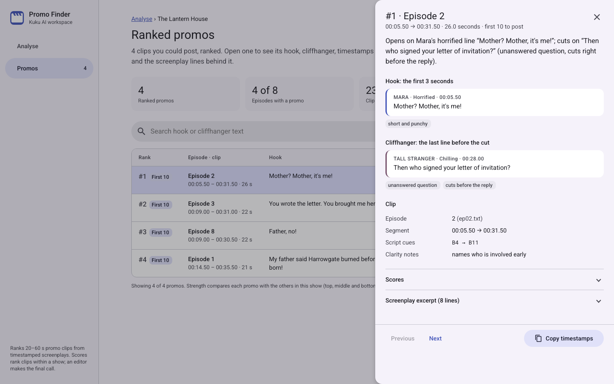
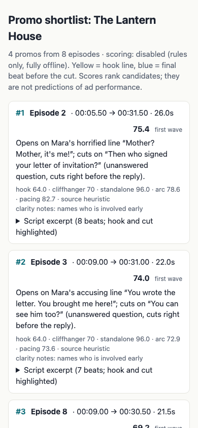
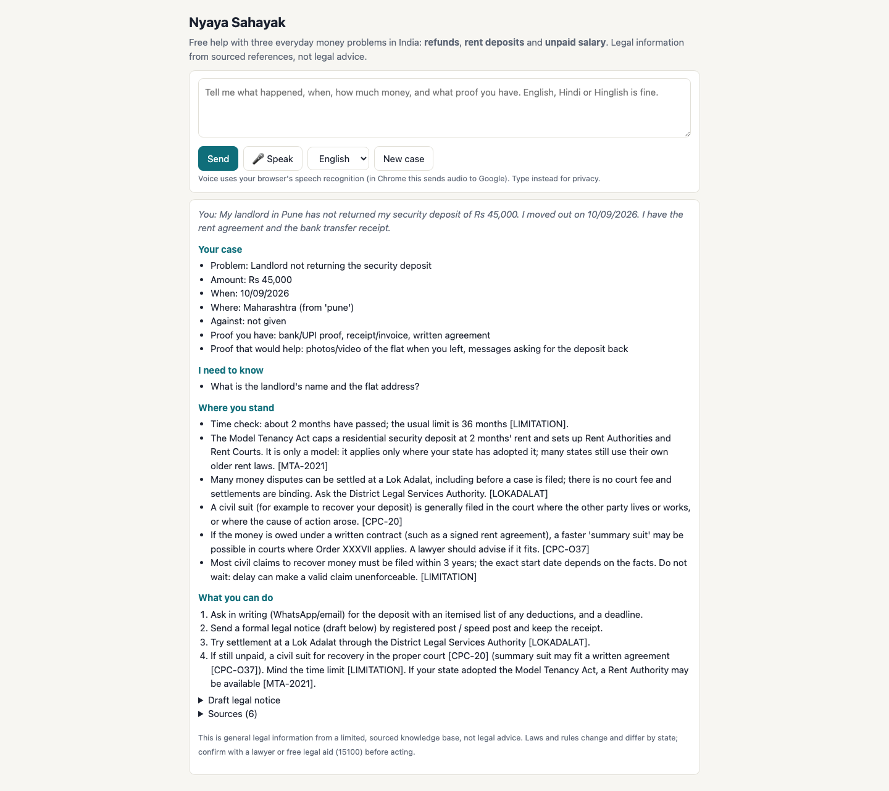
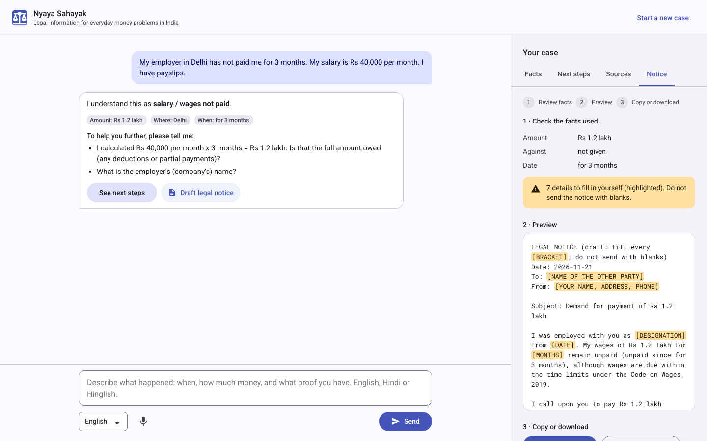
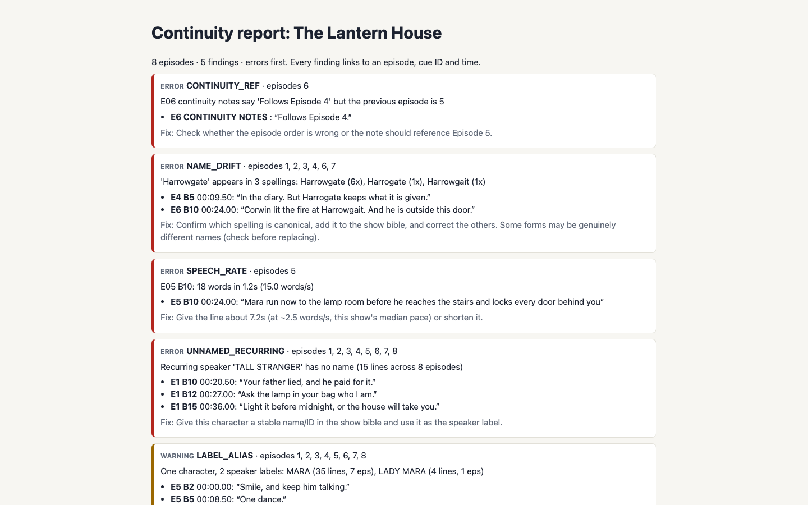
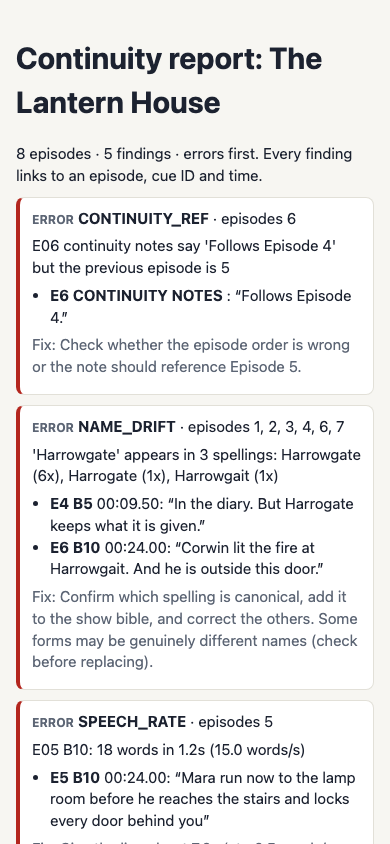

# Frontend redesign report

All three apps now share one Material Design 3 system ([`DESIGN_SYSTEM.md`](DESIGN_SYSTEM.md)). Promo Finder and Continuity Checker previously had only static HTML reports, so each gained a working web app; Nyaya Sahayak's chat page was rebuilt.

**Unchanged:**
- The engines: parsing, scoring, rules, knowledge base, guard.
- Their outputs and every existing CLI command.
- The test suites (they still pass).

## Rules followed

- **Backend logic untouched.**
  - Promo Finder: `pipeline.run()` gained one optional `progress` callback, used only to report "episode i of n". Results are identical: 83 promos on the full pack, through both the CLI and the web app.
  - Continuity Checker: the web server calls the same `load` → `run_checks` → `write_all` as `run.py`. It gives 40 findings, 15 of them errors, matching the CLI.
  - Nyaya Sahayak: `POST /api/turn` is unchanged; the server only gained a fixed allow-list of static files.
- **Every control does something real.** No placeholder buttons and no invented metrics; every number comes from the backend's JSON.
- **No new dependencies.** Standard-library Python servers, plain CSS and JS. Each project still runs on its own.
- **Confidentiality.**
  - Screenshots in this repository use an invented 8-episode show, [`samples/The Lantern House`](samples/), made by [`samples/make_demo_show.py`](samples/make_demo_show.py).
  - Screenshots of the real Kuku show are kept outside the repository.
- **Authorship.** Commits are authored as `swostideep`.

## What changed, per project

### Problem 1: Promo Finder ([`web.py`](problem-1-promo-finder/web.py), [`web/`](problem-1-promo-finder/web/))

**Before:**
- The only interface was a CLI.
- It wrote a static `review.html`: one long page of cards with raw scores ("hook 64.0 · cliffhanger 70 · standalone 96.0 · arc 78.6…") and no search, filter or navigation.

**After:**
- **Analyse view:** choose a show, then "Analyse screenplay". The real pipeline runs in the background, with a determinate progress bar ("Scoring episode 26 of 50…") and a success banner. "View N ranked promos" becomes the primary action, and "Analyse again" becomes secondary.
- **Promos view:**
  - Four summary numbers: promos, episodes covered, windows checked, and episodes with nothing strong enough.
  - Search over hook, cliffhanger and why-it-works text, plus an episode filter and a "First 10 to post" chip.
  - A table of rank, episode and clip time, hook, cliffhanger and strength. Strength is a label (Strong / Solid / Weaker) for the top, middle and bottom third within the show; the method is stated under the table.
- **Detail side sheet:**
  - Why it works, the hook quote with its reasons, and the cliffhanger quote with its reasons.
  - Clip metadata: file, segment, cue IDs and clarity notes.
  - Collapsed sections: five score meters, and the screenplay excerpt with the hook and cut lines highlighted.
  - Actions: Previous / Next, and "Copy timestamps" for the editor's cut list.
- **Endpoints:** `GET /api/shows`, `POST /api/analyse`, `GET /api/status`, `GET /api/results`.

### Problem 2: Nyaya Sahayak ([`app.py`](problem-2-nyaya-sahayak/app.py), [`web/`](problem-2-nyaya-sahayak/web/))

**Before:** a single page with a chat column and a dense facts box. The draft notice was inline text, and citations were plain IDs.

**After:**
- **Top app bar** with "New case".
- **Welcome state:** three topic starters (refund, rent deposit, unpaid salary). Each inserts a starter message with `[brackets]` to fill in, so nothing is sent until the user edits it.
- **Chat:**
  - A disclaimer banner.
  - A composer: auto-growing text area, Enter to send, Shift+Enter for a new line, language select, and the mic for Chrome speech recognition.
  - A typing indicator.
- **Case panel** (a side sheet below 1024 px) with four ARIA tabs:
  - **Facts:** what the assistant has understood.
  - **Next steps.**
  - **Sources:** each knowledge-base provision with its verification level.
  - **Notice:** a three-step flow, with the blanks still to fill highlighted and counted, "Copy notice", and "Download .txt".
- **Citations:** `[ID]` citations in replies are buttons that open the Sources tab and highlight that source.

### Problem 3: Continuity Checker ([`web.py`](problem-3-continuity-checker/web.py), [`web/`](problem-3-continuity-checker/web/))

**Before:** the CLI wrote a static `report.html`, a long list of cards headed by rule codes (`NAME_DRIFT`, `SPEECH_RATE`…), with no filtering.

**After:**
- **Run checks view:** choose a show, then "Run checks". It takes about 0.2 s on 50 episodes and ends with a summary banner. "What gets checked" explains each rule in plain words.
- **Findings view:**
  - Summary numbers: errors, warnings, episodes affected, and cues checked.
  - Filters: severity chips (All / Errors / Warnings), a check filter using friendly names with counts, an episode filter, and search.
  - The table leads with plain language ("Name spelled differently"). The rule code stays as a quiet column on desktop.
  - Export CSV is a real download of the triage spreadsheet the CLI writes.
- **Detail side sheet:**
  - The finding, a one-line explanation of the rule, and the suggested fix.
  - Evidence: a spelling table with counts and episodes, the label table, the likely identity of an unnamed speaker, or the words-per-second calculation.
  - Every location, each with "Show surrounding lines". This fetches the two cues before and after from `/api/context` and highlights the flagged line.
  - "Copy locations".
- **Endpoints:** `GET /api/shows`, `POST /api/check`, `GET /api/results`, `GET /api/context`, `GET /api/export`.

## Before and after

All images are in [`docs/screenshots/`](docs/screenshots/): 8 before, 34 after. They were captured with Playwright (headless Chromium).

| | Before | After |
|---|---|---|
| Promo Finder, list |  |  |
| Promo Finder, detail | (no detail view) |  |
| Promo Finder, mobile |  |  |
| Nyaya Sahayak |  |  |
| Nyaya Sahayak, notice | (inline text) |  |
| Continuity Checker, list |  |  |
| Continuity Checker, detail | (no detail view) |  |
| Continuity Checker, mobile |  |  |

## Verification

**Tests** (all pass):

| Project | Tests | New |
|---|---|---|
| Promo Finder | 52 | 4 web API tests: list shows, analyse runs the real pipeline and matches the files on disk, 404/400 errors and no path traversal, assets served |
| Nyaya Sahayak | 18 | — |
| Continuity Checker | 19 | 4 web API tests: check matches the rules, context returns ±2 cues, CSV export, 404/400 errors |

**Screenshot checks.** The Playwright run checks each shot for horizontal overflow, controls smaller than 24 × 24 px, and console errors. The final run passed 28 of 28 shots across the desktop, laptop, tablet and mobile viewports. Defects found and fixed along the way:
- 3 px overflow on mobile (Nyaya top bar).
- Misaligned composer (inline textarea).
- Case toggle visible on desktop.
- Breadcrumb link under 24 px.
- Two filled buttons competing after analysis.
- Stale "Not analysed yet" hint.
- Grey pill on the disabled text button.
- Squeezed check filter on mobile.
- Redundant "Clip" and "Severity" labels on mobile cards.

**Workflows driven end to end:**
- Analyse → list → open promo → Previous / Next → Escape closes, and focus returns to the row.
- Search, episode filter and the "First 10 to post" chip.
- Run checks → filter warnings → filter by check → open finding → show surrounding lines → Export CSV (download headers and content checked).
- Search with no matches → empty state → "Clear filters".
- The mobile drawer.

**Real data.** Both new apps were run on the full 50-episode pack. Promo Finder gave 83 promos (46 of 50 episodes, 14,615 windows); Continuity Checker gave 40 findings with 15 errors. Both match the CLI. These screenshots are kept outside the repository.

## How to run

Each command runs from its project folder, and the app opens at the URL shown.

```bash
cd problem-1-promo-finder && python3 web.py --shows "path/to/folder_of_shows"
```
Promo Finder: http://localhost:8701. `--shows` accepts one show folder or a folder of show folders.

```bash
cd problem-2-nyaya-sahayak && python3 app.py web
```
Nyaya Sahayak: http://localhost:8765.

```bash
cd problem-3-continuity-checker && python3 web.py --shows "path/to/folder_of_shows"
```
Continuity Checker: http://localhost:8703.

Try the two screenplay apps without the Kuku pack:

```bash
python3 samples/make_demo_show.py
```
```bash
cd problem-1-promo-finder && python3 web.py --shows ../samples
```

The CLIs are unchanged: `python3 run.py --show …` still writes the same files, including the old static `review.html` / `report.html`.

## Limitations

**Theme and fonts:**
- Light theme only; there is no dark mode yet. The tokens are structured so a dark scheme is one extra `:root` block.
- Roboto comes from Google Fonts. Offline, the system font is used instead.

**Shared files:**
- The shared CSS and JS are copied into each `web/` folder, to keep the projects independent. Edit `design-system/` and re-copy (command in `DESIGN_SYSTEM.md`).

**Feature gaps:**
- The optional LLM reviewers (Promo Finder judge, Continuity model review) are CLI-only. The web apps run the offline engines.
- Promo Finder's job status lives in server memory. Restarting the server during an analysis loses that run's progress, but finished results on disk are kept.
- The demo show is short (about 40 s episodes), so Promo Finder finds only 4 promos there. The full pack gives 83.

**Accessibility testing:**
- Automated checks, contrast calculation and keyboard walk-throughs only.
- Not yet tested with a screen reader or by real users.
