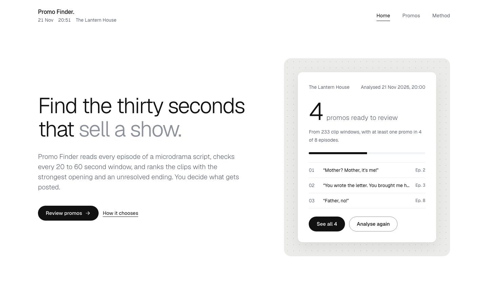
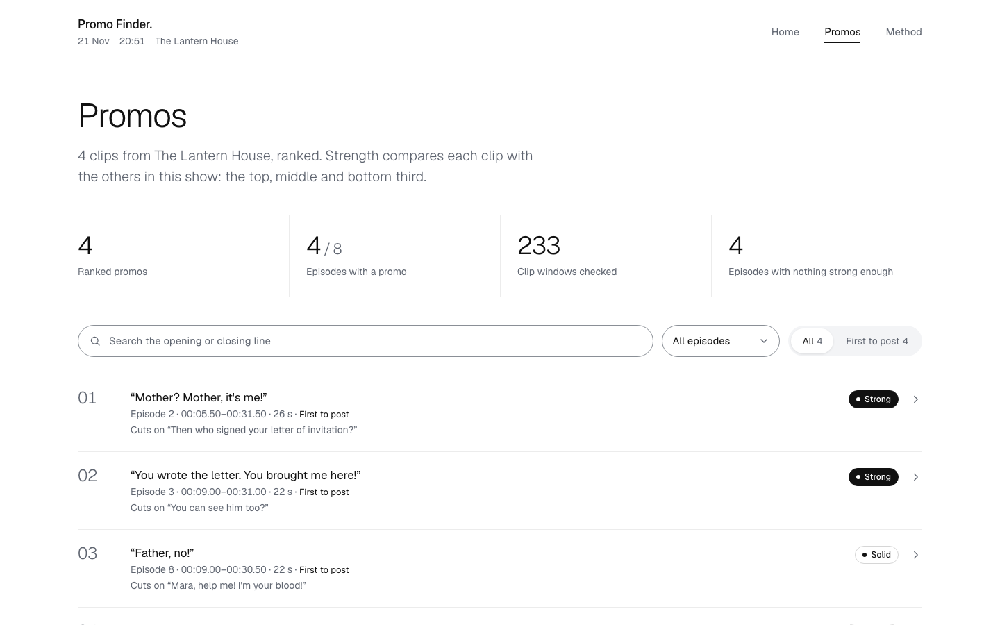
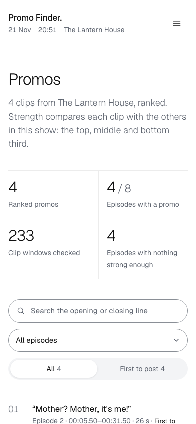
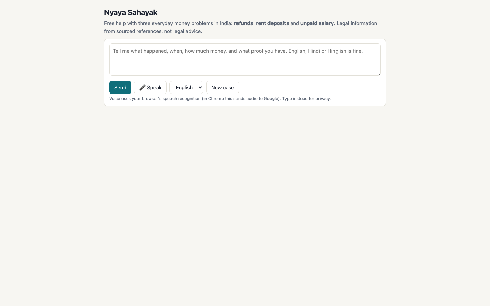
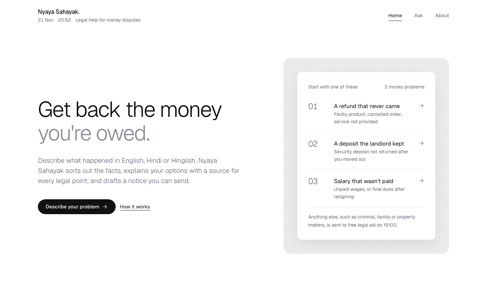
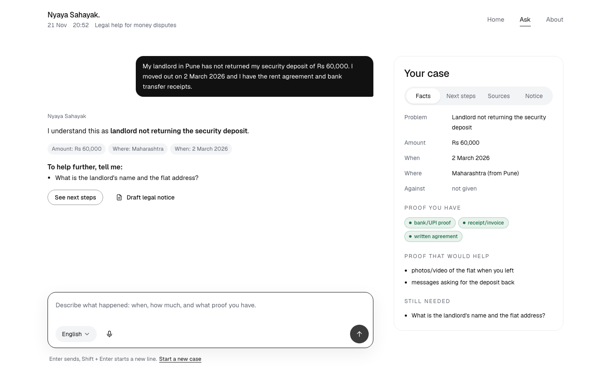
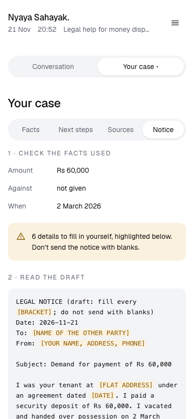
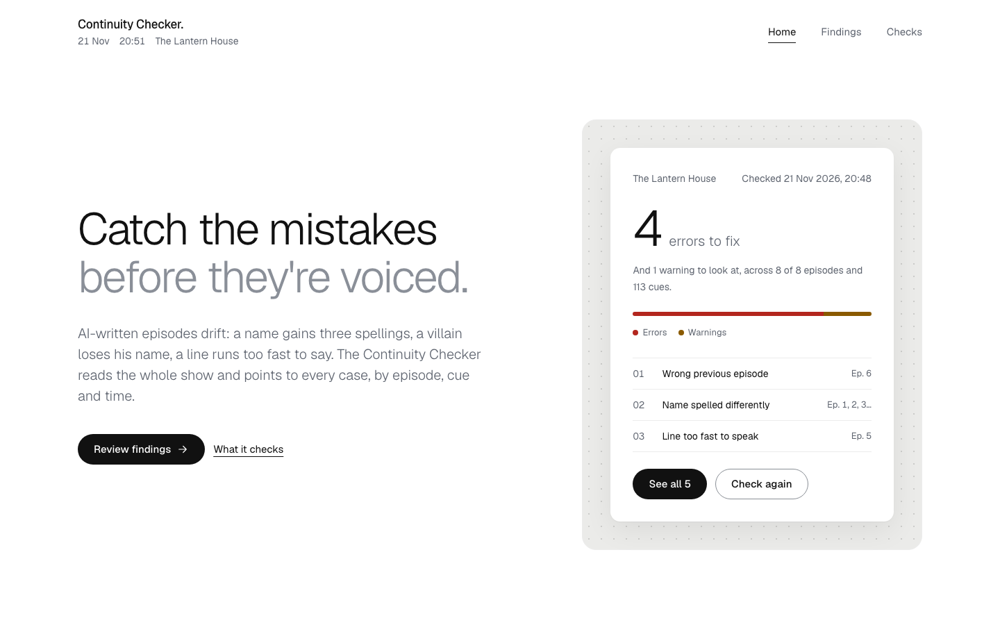
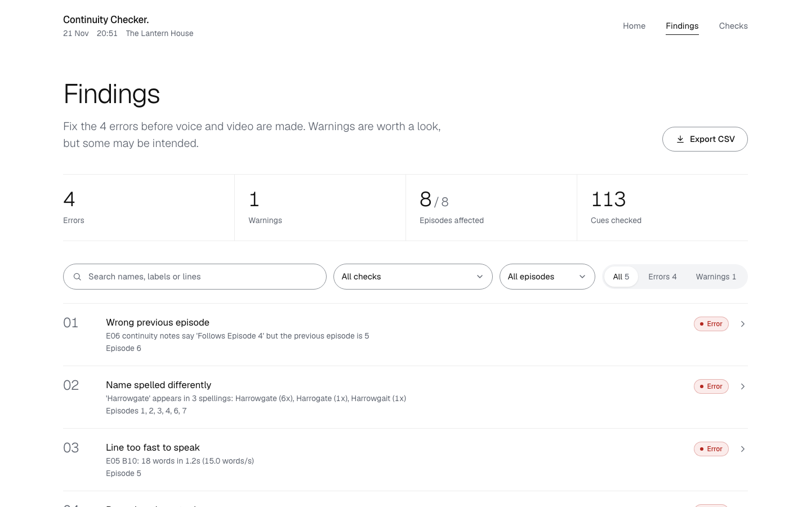
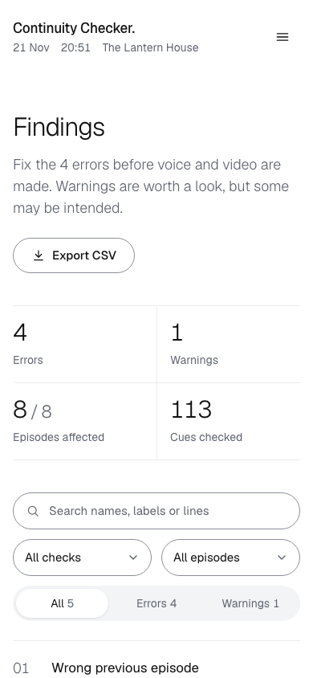

# The three tools as websites

After the main build I turned the three tools into proper websites with one shared design system ([`DESIGN_SYSTEM.md`](DESIGN_SYSTEM.md)). Promo Finder and
the Continuity Checker had only produced static report pages; Nyaya Sahayak was a single chat page. The engines, their
outputs and every command-line tool are unchanged, and all the tests still pass.

## Ground rules I kept to

The backend logic stays as it was. Promo Finder's pipeline gained one optional progress callback, used only to show
“episode 26 of 50”, and still produces the same 83 promos on the full pack. The Continuity Checker's web server calls
the same functions as its command line and gives the same 40 findings. Nyaya Sahayak's chat API is untouched.

Every button does something real, and every number on screen comes from the tool's own output. There are no new
dependencies: the servers use Python's standard library and the pages are plain HTML, CSS and JavaScript. Each project
still runs on its own.

The screenshots in the public repository use an invented eight-episode show, *The Lantern House*, so they contain no
Kuku material. Screenshots of the real show were taken too, but kept off the public repository.

## The design

The direction is monochrome and quiet: white paper, near-black ink, greys and plenty of space, set in a single
typeface, Geist, which is light at large sizes and regular for reading. Colour appears only where it means
something: red for errors, amber for warnings, and two soft highlights for the opening and closing lines of a promo.
Buttons are black pills, sections have small left-aligned titles, and each home page shows its one important number
on a white card sitting on a dotted grey panel. Dark mode follows the operating system.

Each site is now a real website with a header, a home page, a list, a page for every item and an explanation page.
Every item has its own address, so the back button works and links can be shared. Contrast meets the WCAG AA
standard throughout: body text is 18.9 to 1, secondary text at least 4.9 to 1, and input borders 3.3 to 1.

## Promo Finder

The home page leads with “Find the thirty seconds that sell a show.” Beside it, a card shows the number of promos ready
to review, how many episodes they cover, the top three, and buttons to see them all or analyse again. While an
analysis runs, the same card shows the episode count climbing with a progress bar. Below are four numbered cards on how
it works, and a panel explaining why a strong ending can't rescue a weak opening, with the actual minimum scores.

The Promos page lists every clip as a row: rank, opening line, episode and timing, closing line, and a Strong, Solid or
Weaker label (the top, middle and bottom third within the show). It can be searched and filtered by episode or to the
first ten to post. Each promo has its own page with why it works, the opening and closing lines, the scores, the clip
details, the screenplay with both lines highlighted, previous and next buttons, and a button to copy the timestamps.

## Nyaya Sahayak

The home page leads with “Get back the money you're owed.” The card beside it lists the three problems it handles;
choosing one opens the conversation with a starter message to complete. Numbered cards explain the four steps, and a
panel sets out the principle that it never makes up the law, with the helpline numbers.

The Ask page keeps the conversation and the case side by side: messages on the left, and on the right a panel with the
facts it understood, the next steps, the sources and the draft notice. On phones the two become a Conversation / Your
case switch. Citations in a reply open the matching source. The notice highlights the blanks still to fill and can be
copied or downloaded. Voice input no longer repeats words.

## Continuity Checker

The home page leads with “Catch the mistakes before they're voiced.” Its card shows the number of errors to fix, the
warnings, a red and amber bar for the balance between them, and the first three findings. The Findings page can be
searched and filtered by severity, type of check and episode, and exports the CSV. Each finding has its own page with
why it matters, the suggested fix, the evidence (such as every spelling with counts and episodes) and each location,
where *Show surrounding lines* loads the cues before and after.

## Before and after

All screenshots are in [`docs/screenshots/`](docs/screenshots/) and use the invented demo show.

| | Before | After |
|---|---|---|
| Promo Finder, home |  |  |
| Promo Finder, list | (one long static page) |  |
| Promo Finder, one promo | (no detail view) |  |
| Promo Finder, phone |  |  |
| Nyaya Sahayak, home |  |  |
| Nyaya Sahayak, conversation |  |  |
| Nyaya Sahayak, notice on a phone | (inline text) |  |
| Continuity Checker, home |  |  |
| Continuity Checker, findings | (one long static page) |  |
| Continuity Checker, one finding | (no detail view) |  |
| Continuity Checker, phone |  |  |

## How I checked it

| Check | Result |
|---|---|
| Automated tests | Promo Finder 52, Nyaya Sahayak 18, Continuity Checker 19: all pass |
| Screenshot checks | 45 of 45 pass across desktop, laptop, tablet and phone: no sideways scrolling, no control smaller than 24 pixels, no console errors |
| Workflows | Analyse and watch progress; filter, search and open items; previous and next; copy; export; the empty state; the phone menu; a full Nyaya conversation, notice copy and download; voice input with simulated speech events |
| Real data | Both script tools run on the full 50-episode pack and match the command line: 83 promos and 40 findings |

## Limits

Geist loads from Google Fonts, so offline the system font is used. The shared files are copied into each project to
keep them independent, so a change has to be copied to all three. The optional language-model features are still
command-line only. Promo Finder keeps a running analysis's status in memory, so restarting the server mid-run loses
that progress (finished results are kept). I haven't tested with a screen reader or with real users.

## Running it

Run each command from the project's folder, then open the address.

```bash
cd problem-1-promo-finder && python3 web.py --shows "path/to/folder_of_shows"
```
Promo Finder: http://localhost:8701

```bash
cd problem-2-nyaya-sahayak && python3 app.py web
```
Nyaya Sahayak: http://localhost:8765

```bash
cd problem-3-continuity-checker && python3 web.py --shows "path/to/folder_of_shows"
```
Continuity Checker: http://localhost:8703

To try the two script tools without the Kuku pack, run `python3 samples/make_demo_show.py` from the repository root and
pass `--shows ../samples`.
